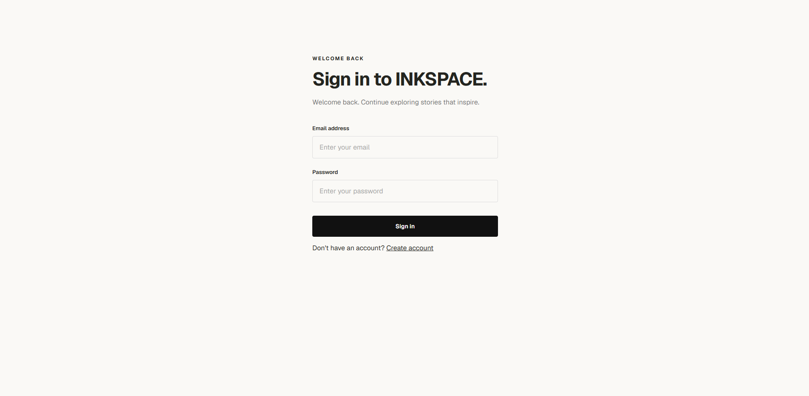
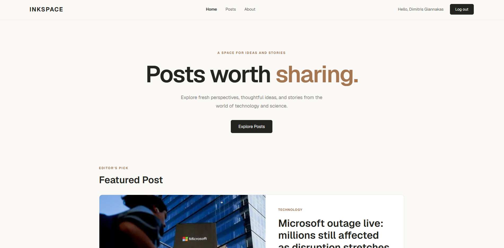
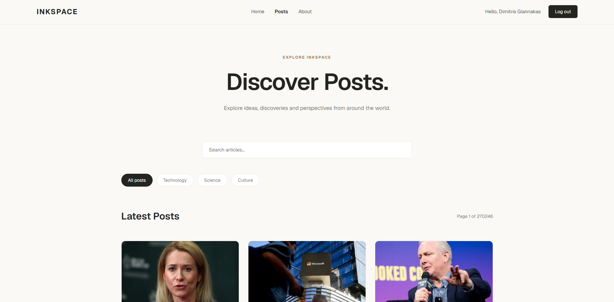

# INKSPACE

A modern, responsive editorial news platform built with **Next.js, React, and TypeScript**.

INKSPACE offers a clean reading experience where users can discover stories, explore different topics, and search for articles powered by **The Guardian Open Platform API**.

The application includes secure user authentication, protected routes, and a PostgreSQL database powered by Neon and Prisma.

**[Live Demo](https://inkspace-delta.vercel.app/login)** · **[GitHub Repository](https://github.com/dhmgiannakas-dev/inkspace)**

## Screenshots

### Login / Register



### Home Page



### Explore Posts



## Features

- **User Authentication** — Email/password registration, login, and session management using Better Auth.
- **Protected Routes** — Server-side session validation to restrict access to authenticated users.
- **Editorial Homepage** — Featured articles and recent stories focused on technology and science.
- **News API Integration** — Dynamic article content fetched from The Guardian API.
- **Article Search** — Debounced search functionality with URL-synchronized query parameters.
- **Category Filtering** — Browse articles by Technology, Science, and Culture.
- **Pagination** — Navigate through paginated article results.
- **Article Detail Pages** — View article information, publication dates, images, summaries, and original source links.
- **Responsive Design** — Custom CSS layouts designed for different screen sizes.
- **Loading & Error States** — Loading skeletons, error boundaries, and custom not-found pages.
- **Dynamic Metadata** — Page-specific titles and descriptions using Next.js Metadata API.

## Tech Stack

| Category | Technologies |
|---|---|
| Framework | Next.js 16 (App Router) |
| Frontend | React 19 |
| Language | TypeScript 5 |
| Styling | CSS |
| Database | PostgreSQL |
| Database Hosting | Neon |
| ORM | Prisma 7 |
| Database Adapter | `@prisma/adapter-neon` |
| Authentication | Better Auth |
| Validation | Zod |
| External API | The Guardian Open Platform |
| Font | Geist |
| Code Quality | ESLint |
| Deployment | Vercel |

## Architecture

INKSPACE uses the **Next.js App Router**, combining Server Components and Client Components.

### Frontend

The interface is built with React and TypeScript, using custom CSS for responsive layouts.

Next.js Server Components handle server-side data fetching, while Client Components provide interactive features such as authentication forms and article search.

### Authentication

Authentication is implemented with Better Auth.

- Email and password registration
- User login
- Session management
- Server-side protected route validation
- PostgreSQL persistence through Prisma

Unauthenticated users attempting to access protected pages are redirected to `/login`.

### Database

The application uses Neon PostgreSQL with Prisma ORM.

Prisma manages the database schema, migrations, and type-safe database access.

The database stores authentication-related information, including users, sessions, accounts, and verification records.

### News Content

Articles are fetched from The Guardian Open Platform API.

The application supports article search, category filtering, pagination, and individual article pages.

Server-side caching helps reduce repeated API requests.

## Project Structure

```text
src/
├── app/
│   ├── (protected)/
│   │   ├── about/
│   │   ├── posts/
│   │   ├── layout.tsx
│   │   └── page.tsx
│   ├── api/
│   │   └── auth/
│   ├── login/
│   ├── register/
│   ├── globals.css
│   └── layout.tsx
├── components/
├── lib/
│   ├── articles.ts
│   ├── auth.ts
│   ├── auth-client.ts
│   ├── prisma.ts
│   └── validations/
└── types/

prisma/
├── schema.prisma
└── migrations/

prisma7.config.ts
```

## Getting Started

### Prerequisites

- Node.js
- npm
- Neon PostgreSQL database
- The Guardian API key

### 1. Clone the repository

```bash
git clone https://github.com/dhmgiannakas-dev/inkspace.git
cd inkspace
```

### 2. Install dependencies

```bash
npm install
```

### 3. Configure environment variables

Create a `.env.local` file in the root directory:

```env
DATABASE_URL="your-neon-pooled-connection-string"
DIRECT_URL="your-neon-direct-connection-string"

GUARDIAN_API_KEY="your-guardian-api-key"

BETTER_AUTH_SECRET="your-secret-key"
BETTER_AUTH_URL="http://localhost:3000"
```

Keep environment variables and credentials private. Do not commit `.env.local` to GitHub.

### 4. Set up Prisma

Apply the database migrations:

```bash
npx prisma migrate deploy --config ./prisma7.config.ts
```

Generate the Prisma Client:

```bash
npx prisma generate --config ./prisma7.config.ts
```

### 5. Run the development server

```bash
npm run dev
```

Open [http://localhost:3000](http://localhost:3000) in your browser.

## Available Scripts

| Command | Description |
|---|---|
| `npm run dev` | Start the development server |
| `npm run build` | Generate Prisma Client and build for production |
| `npm run start` | Start the production server |
| `npm run lint` | Run ESLint |

## Deployment

INKSPACE is deployed on **Vercel**.

**Live Application:** https://inkspace-delta.vercel.app/login

The production environment uses Neon PostgreSQL for authentication data and The Guardian API for news content.

## What I Learned

Through this project, I gained practical experience with:

- Building applications with Next.js App Router
- Working with React Server Components and Client Components
- Using TypeScript in a full-stack application
- Implementing authentication and protected routes
- Integrating external REST APIs
- Managing PostgreSQL databases with Prisma
- Building search, filtering, and pagination features
- Handling loading states, errors, and dynamic metadata
- Deploying a full-stack application to Vercel

## Author

**[dhmgiannakas-dev](https://github.com/dhmgiannakas-dev)**

Built as a personal full-stack development project.

## Content Attribution

News content is provided by [The Guardian Open Platform](https://open-platform.theguardian.com/).

Articles link to their original publications on The Guardian.